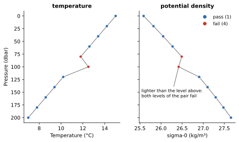

Density Inversion
=================

:Item: ``density_inversion``
:Test: RTQC14
:Level: observation (temperature and salinity jointly)
:Output: ``temp_qc_density_inversion``, ``psal_qc_density_inversion``

Why Check It
------------

Heavier water sinks below lighter water, so in a stable water column the
density increases with depth. A level that is markedly lighter than the one
above it is not stable, and real inversions are small and short-lived. A
large one usually means the temperature or the salinity at one of the two
levels is wrong. Because density combines both variables, the test can find
errors that look harmless in each variable alone.

How It Works
------------

The potential density anomaly sigma-0 (UNESCO 1983) is computed from
temperature, salinity and pressure at every level. Consecutive levels are
then compared in both directions:

* going down, a level fails when it is lighter than the level above by more
  than ``threshold``;
* going up, a level fails when it is heavier than the level below by more
  than ``threshold``.

Together these flag **both levels** of an inverted pair, since the test
cannot tell which of the two is wrong.

         profile; the warm level and the level above it fail.
   :width: 100%

   Flags computed by the item. A level 1.5 °C warmer than expected is lighter
   than the level above it, so both levels of the pair fail.

Parameters
----------

.. code-block:: yaml

   - name: density_inversion
     params: { threshold: 0.03 }

``threshold``
   The inversion allowed, in kg/m³. Smaller inversions pass.

Things to Know
--------------

* The two output columns always carry the same flags: the inversion is a
  property of the pair of levels, not of one variable.
* A level whose temperature, salinity or pressure is missing has no density
  and passes. So does one whose values are physically impossible (a negative
  salinity, a fill value such as -999), because the equation of state is
  undefined there; the range tests catch those instead. This also keeps a
  good level next to a fill value from being flagged.
* In fresh or brackish water (low salinity), temperature dominates density,
  and the temperature of maximum density matters. Review the flags in such
  regions before relying on them.
