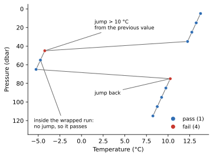

Digit Rollover
==============

:Item: ``digit_rollover``
:Test: RTQC12
:Level: observation
:Output: ``temp_qc_digit_rollover``, ``psal_qc_digit_rollover``

Why Check It
------------

Some instruments store temperature and salinity in a fixed number of bits.
When a value goes past the largest number those bits can hold, the stored
value wraps around to the low end, like an odometer. The profile is normally
corrected for this when it is built; when it is not, the wrapped values jump
by a large, fixed amount from their neighbours. The test looks for those
jumps.

How It Works
------------

An observation fails when its value differs from the **previous** observation
in the profile by more than the variable's threshold (10 °C for temperature,
5 for salinity by default).

         first offset level and the level where the profile returns fail.
   :width: 70%

   Flags computed by the item. Three levels have wrapped. The jump into the
   wrapped run and the jump back out fail; the levels inside the run pass,
   since each is close to the one before it.

Parameters
----------

.. code-block:: yaml

   - name: digit_rollover
     params: { temp: 10.0, psal: 5.0 }

Each key is a variable and its threshold, in the variable's units.

Things to Know
--------------

* As the diagram shows, the test flags the **edges** of a wrapped run, not the
  whole run. The levels in between often fail other tests (global or regional
  range), which then decide the final flag.
* The first observation of a profile has no previous value and passes.
* A missing value (null or ``NaN``) passes, and so does the value after it.
