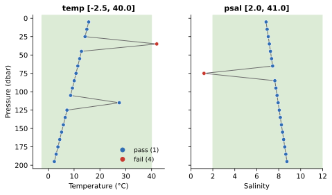

Global Range
============

:Item: ``global_range``
:Test: RTQC6
:Level: observation
:Output: ``temp_qc_global_range``, ``psal_qc_global_range``

Why Check It
------------

Some values cannot occur anywhere in the ocean. Sea water freezes at about
-2 °C, and no open ocean water is warmer than about 40 °C; salinity has
similar physical limits. A value outside them is a sensor fault, a wrong unit
or scale factor, or a fill value such as ``-999`` or ``99999`` that was
never replaced by a missing value. The test is a gross filter: the ranges
are wide enough to pass every real extreme, so whatever it flags is certainly
wrong.

How It Works
------------

An observation fails when its value lies outside the variable's
``[min, max]`` (both bounds inclusive). Each variable is checked on its own.

         temperature of 42 and a salinity of 1.2 fail.
   :width: 100%

   Flags computed by the item. The shaded band is the valid range. The
   temperature of 27.5 °C at 115 dbar passes here; the :doc:`regional_range`
   page shows how a regional range catches it.

Parameters
----------

.. code-block:: yaml

   - name: global_range
     params: { temp: { min: -2.5, max: 40.0 },
               psal: { min: 2.0, max: 41.0 } }

Each key under ``params`` is a variable with its range, and the variables
listed are the ones checked. To check a variable with a different name, add
it with its own range.

Things to Know
--------------

* A missing value (null or ``NaN``) passes, since it cannot be
  range-checked.
* Because the ranges are so wide, this test rarely fires on real data, and
  then mostly on fill values. A value it lets through can still be wrong for
  its region or depth; that is the job of the regional range, spike and
  gradient tests.
