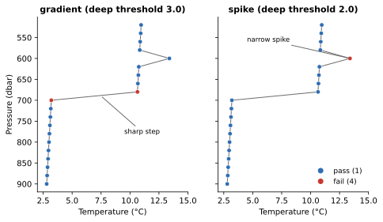

Gradient
========

:Item: ``gradient``
:Test: RTQC11
:Level: observation
:Output: ``temp_qc_gradient``, ``psal_qc_gradient``

Why Check It
------------

Temperature and salinity can change quickly with depth, at a thermocline or
halocline, but only up to a point. A change much steeper than the ocean
produces between two neighbouring levels points to a sensor jump or an
offset that starts mid-profile. Unlike the spike test, the gradient test does
not ask whether the value comes back: it flags a sharp step as well as a
spike.

How It Works
------------

With V2 the value under test and V1, V3 its neighbours above and below, the
test value is

.. code-block:: text

   | V2 - (V3 + V1) / 2 |

that is, how far V2 is from the midpoint of its neighbours. It is the
:doc:`spike` formula without the second term, so a steep slope is not
excused. V2 fails when the test value exceeds the depth-dependent threshold:
``shallow`` above ``depth_threshold``, ``deep`` from there down.

         gradient flags the two levels at a sharp step, spike flags the narrow
         spike.
   :width: 100%

   Flags computed by both items on the same profile, below 500 dbar where the
   deep thresholds apply. The gradient test flags both levels at the sharp
   step (test value 3.7 > 3.0) but not the narrow spike (2.6 < 3.0). The
   spike test does the opposite: the step scores 0, the spike 2.6 > 2.0.

Parameters
----------

.. code-block:: yaml

   - name: gradient
     params: { temp: { shallow: 9.0, deep: 3.0 },
               psal: { shallow: 1.5, deep: 0.5 },
               depth_threshold: 500 }

The thresholds are higher than the spike test's, because a steep slope is
normal and the formula does not discount it.

Things to Know
--------------

* A step flags the levels on both sides of it, since each has the step
  between it and one neighbour.
* A null value passes, and so do its neighbours. A ``NaN`` fails, and so
  do both its neighbours; see
  :ref:`ctddump-nan`.
* The first and last observations of a profile, and values next to a missing
  one, always pass.
* The test is sensitive to the vertical resolution: at coarse spacing, a real
  thermocline falls between fewer levels and looks steeper.
