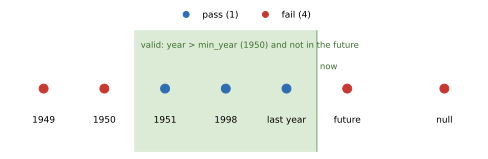

Impossible Date
===============

:Item: ``impossible_date``
:Test: RTQC2
:Level: profile
:Output: ``qc_impossible_date``

Why Check It
------------

The date places a profile in time. Every later use of the data depends on it:
matching profiles to each other, building climatologies, finding duplicates,
or simply deciding whether a measurement is recent. A corrupted date usually
comes from a clock that was never set, a transmission error, or a decoding
problem, and it cannot be repaired automatically. The test catches the cases
that are certainly wrong.

How It Works
------------

A profile fails when its timestamp:

* is **missing** (null; a date that could not be parsed also ends up null),
* falls in a year **not after** ``min_year`` (1950 by default, so 1950
  itself fails), or
* lies **in the future** at the time of processing (compared in UTC).

         missing timestamp fail, the others pass.
   :width: 100%

   Flags computed by the item on one profile per timestamp. The axis is not
   to scale.

The result applies to every observation of the profile.

Parameters
----------

.. code-block:: yaml

   - name: impossible_date
     params: { min_year: 1950, timestamp_column: profile_timestamp }

``min_year``
   Years up to and including this one fail.

``timestamp_column``
   The datetime column to check.

Things to Know
--------------

* The "future" boundary moves: a profile timestamped a few minutes ahead of
  the processing clock fails today and would pass tomorrow. Rerunning old
  data can therefore change this flag only for profiles that were in the
  future when first processed.
* Only the profile timestamp is checked, not the time of each observation.
