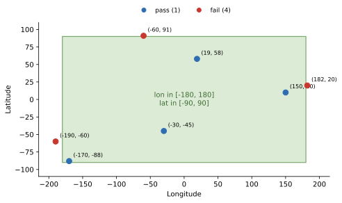

Impossible Location
===================

:Item: ``impossible_location``
:Test: RTQC3
:Level: profile
:Output: ``qc_impossible_location``

Why Check It
------------

Like the date, the position is needed by almost everything done with a
profile, including the other tests: the regional range depends on the
region, and the position on land test on the sea floor depth there. A
latitude of 91° or a longitude of 200° is not a slightly wrong position but
a corrupted one, and nothing downstream should use it.

How It Works
------------

A profile fails when its latitude or longitude is **missing**, or lies
outside the bounds (inclusive): latitude in [-90, 90] and longitude in
[-180, 180].

         ones outside it fail.
   :width: 90%

   Flags computed by the item. (182, 20), (-60, 91) and (-190, -60) fall
   outside the box.

Parameters
----------

.. code-block:: yaml

   - name: impossible_location
     params: { lat_min: -90, lat_max: 90, lon_min: -180, lon_max: 180 }

Narrowing the bounds turns the test into a coarse region check, but the
:doc:`regional_range` and :doc:`position_on_land` tests are the better tools
for that.

Things to Know
--------------

* Longitudes written in the 0 to 360 convention fail above 180. Convert them
  to -180 to 180 before running, or widen ``lon_max`` to 360.
* The test checks that a position is *possible*, not that it is *right*: a
  position swapped between latitude and longitude usually passes. The
  position on land test catches some of those.
