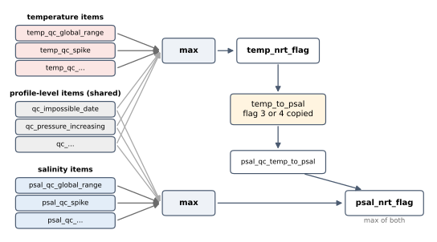

QC Items: Overview
==================

A QC item is one automated test. Each item looks for one kind of error that
can be recognised without human judgement, and writes one flag per
observation: ``1`` where the observation passed, and the item's fail flag
(``4``, bad, by default) where it failed. Eleven items are the Argo/CTD
real-time tests RTQC2 to RTQC14; ``temp_to_psal`` is the propagation rule
from the same recommendation.

The items are implemented in ``aiqclib``, as ordinary feature classes
(``qc_spike``, ``qc_global_range``, ...), which is why they can also be used
as training features there; see :doc:`aiqclib:features/qc_items`.

.. list-table::
   :header-rows: 1
   :widths: 26 10 14 50

   * - Item
     - Test
     - Level
     - Catches
   * - :doc:`impossible_date`
     - RTQC2
     - profile
     - a timestamp that is missing, too early or in the future
   * - :doc:`impossible_location`
     - RTQC3
     - profile
     - a latitude or longitude that is missing or out of bounds
   * - :doc:`position_on_land`
     - RTQC4
     - profile
     - a position that is not in the ocean
   * - :doc:`global_range`
     - RTQC6
     - observation
     - a value no ocean water can have
   * - :doc:`regional_range`
     - RTQC7
     - observation
     - a value outside what the region allows
   * - :doc:`pressure_increasing`
     - RTQC8
     - observation
     - pressure that stalls or goes back up the profile
   * - :doc:`spike`
     - RTQC9
     - observation
     - a single value sticking out from both neighbours
   * - :doc:`gradient`
     - RTQC11
     - observation
     - too steep a change between neighbouring levels
   * - :doc:`digit_rollover`
     - RTQC12
     - observation
     - a jump caused by a sensor counter wrapping around
   * - :doc:`stuck_value`
     - RTQC13
     - profile
     - a sensor reporting the same value all the way down
   * - :doc:`density_inversion`
     - RTQC14
     - observation
     - lighter water under heavier water
   * - :doc:`temp_to_psal`
     - rule
     - observation
     - salinity computed from a bad temperature

Profile and Observation Level
-----------------------------

A **profile-level** item gives one result for the whole profile, written to
every observation in it: a profile has one date and one position, and a
stuck sensor is stuck throughout. An **observation-level** item judges each
measurement on its own, or against its vertical neighbours.

Neighbours are taken in ``observation_no`` order within a profile (the
``platform_code`` and ``profile_no`` columns identify it). An observation
missing a neighbour the test needs, at the top or bottom of a profile, passes.

Missing Values
--------------

A null measurement **passes** every observation-level test: a missing value
cannot be checked, and failing it would mix "absent" with "bad". The date and
location items are the exception, because a profile without a date or a
position cannot be placed at all.

A floating-point ``NaN``, which is how ``ctddump`` stores a missing value,
counts as missing exactly like null.

Output Columns
--------------

An item that checks one variable at a time writes ``{variable}_qc_{item}``
(``temp_qc_spike``, ``psal_qc_spike``). An item that applies to the whole
observation writes ``qc_{item}`` (``qc_impossible_date``,
``qc_pressure_increasing``). Every item column is an integer that is never
null.

The Final NRT Flag
------------------

The final flag of a variable, ``temp_nrt_flag`` or ``psal_nrt_flag``, is the
**most severe** flag among the variable's own item columns and the shared
``qc_*`` columns. Since the flags are ordered by severity (1 < 3 < 4), that is
their maximum. ``temp_to_psal`` runs after the temperature flag is known and
can raise the salinity flag further:

         psal_nrt_flag, with temp_to_psal copying a bad temperature flag to
         salinity.
   :width: 100%

Two settings change this per item, without changing the set of columns:

``fail_flag``
   ``3`` instead of ``4`` marks a failure as "probably bad", for a test that
   is useful but not conclusive. See :ref:`nrtqc-fail-flag`.

``include_in_final_flag: false``
   The item still runs and writes its column, but does not feed the final
   flag. See :ref:`nrtqc-final-flag-guide`.

Parameters
----------

Each item page lists the item's parameters and their defaults. In the
configuration file, ``params`` overrides the defaults **key by key**, so
overriding the temperature range of ``global_range`` keeps the salinity
default:

.. code-block:: yaml

   qc_item_sets:
     - name: qc_item_set_1
       items:
         - name: global_range
           params: { temp: { min: -2.0, max: 35.0 } }
           fail_flag: 3

An item runs only when it is listed. The configuration template lists every
item except ``position_on_land``.
