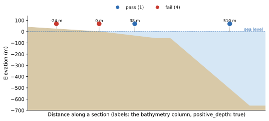

Position on Land
================

:Item: ``position_on_land``
:Test: RTQC4
:Level: profile
:Output: ``qc_position_on_land``
:Not in the template: add it by name; it needs a sea floor depth column

Why Check It
------------

A CTD profile is taken in water, so a position on land is wrong, even when
the latitude and longitude are both within bounds. It typically comes from a
position typed or decoded wrongly, a platform reporting a home port or
default position, or a sign error in one coordinate. The impossible location
test cannot see any of these.

How It Works
------------

The recommendation compares the position with a bathymetry grid. This item
does not read the grid itself: it reads a column already in the input,
holding the **depth of the sea floor at the profile's position**, and fails
the profile when that depth says it is not in the ocean. The tutorial adds
this column with ``seastamp``; see :doc:`../tutorial/seastamp`.

         on land and exactly on the shoreline fail.
   :width: 100%

   Flags computed by the item for four stations. The value above each station
   is its ``bathymetry`` (positive below sea level).

With the default ``positive_depth: true``, the ocean is where the depth is
**greater than 0**. Sea level itself (``0``) counts as land: it is the
shoreline, not a position in the ocean.

Parameters
----------

.. code-block:: yaml

   - name: position_on_land
     params: { depth_column: bathymetry, positive_depth: true }

``depth_column``
   The column holding the sea floor depth. The default is ``bathymetry``
   rather than ``depth`` on purpose: an input may also carry the depth of
   each *measurement*, and reading that as the sea floor would put every
   shallow observation on land.

``positive_depth``
   Which sign means deeper. ``true``: depths are positive below sea level, the
   ocean is ``> 0``. ``false``: elevations are negative below sea level (as
   GEBCO stores them), the ocean is ``< 0``.

Things to Know
--------------

* **Check the sign before enabling the item.** With the wrong
  ``positive_depth`` the test inverts completely: every ocean profile fails.
  ``seastamp depth --positive`` matches the default.
* A **missing column is an error**, not a silent pass, since an input without
  it cannot run the test at all. A null *value* passes: an unknown depth is
  not evidence of land.
* The grid's resolution limits the test near the coast: a profile taken in a
  narrow fjord or harbour can sit on a grid cell that is land. Consider
  ``fail_flag: 3`` if your data has many coastal profiles.
