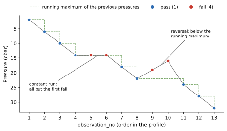

Pressure Increasing
===================

:Item: ``pressure_increasing``
:Test: RTQC8
:Level: observation
:Output: ``qc_pressure_increasing`` (one column, shared by all variables)

Why Check It
------------

A profile is measured on the way down (or up), so pressure should change
monotonically along it. A pressure that repeats or goes back the other way
means the instrument stalled, the sensor misbehaved, or records were
reordered or duplicated. Each such level is in doubt, and the tests that
compare vertical neighbours (spike, gradient, digit rollover, density
inversion) are only meaningful when the neighbours really are above and
below each other.

How It Works
------------

Pressures are read in ``observation_no`` order. An observation fails when its
pressure:

* **equals the previous pressure** (in a run of equal pressures, all but the
  first fail), or
* is **below the running maximum** of all the pressures before it (every
  level of a reversal fails until the profile is deeper than it has ever
  been).

         reversal; the repeated and the reversed levels fail.
   :width: 100%

   Flags computed by the item. The dashed line is the deepest pressure reached
   so far. Observations 9 and 10 fail because they are shallower than
   observation 8, the deepest level reached before them.

Parameters
----------

None:

.. code-block:: yaml

   - name: pressure_increasing

Things to Know
--------------

* Pressure is shared by every variable, so the item writes one column, and
  it feeds the final flag of every variable.
* ``ctddump concat`` sorts each profile by pressure before numbering the
  observations, so in its output this test can only catch repeated
  pressures. Pass ``--no-pres-sort`` to keep the recorded order if you want
  reversals to be caught.
* A null pressure passes. ``ctddump concat`` drops rows without pressure by
  default.
