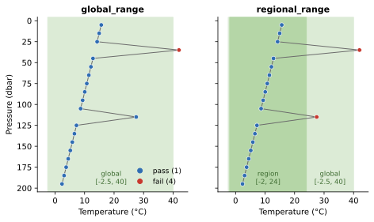

Regional Range
==============

:Item: ``regional_range``
:Test: RTQC7
:Level: observation
:Output: ``temp_qc_regional_range``, ``psal_qc_regional_range``
:Region dependent: the ranges must be set for each region

Why Check It
------------

The global range has to pass the warmest tropical surface water and the
saltiest marginal sea, so it is far too wide for any one region. A
temperature of 28 °C is unremarkable in the tropics but impossible in the
Baltic, and a salinity of 38 is normal in the Mediterranean but not in the
Baltic either. The regional range applies tighter limits that are known to
hold for one sea.

How It Works
------------

The same check as :doc:`global_range`, with the region's bounds: an
observation fails when its value is outside ``[min, max]`` (inclusive).

         regional range; 27.5 °C passes the global range and fails the
         regional one.
   :width: 100%

   Flags computed by both items on the same profile, with an illustrative
   regional range of [-2, 24] °C. The 27.5 °C value passes the global range
   but not the regional one.

Parameters
----------

There are **no defaults**. List each variable with its range:

.. code-block:: yaml

   - name: regional_range
     params: { temp: { min: -2.0, max: 24.0 },
               psal: { min: 0.0, max: 38.0 } }

The values above are an illustration. Take your region's from the QC manual
your data centre follows.

Things to Know
--------------

* Without ``params`` the item raises an error instead of passing everything,
  so a configuration cannot silently run it with no ranges.
* The item does not detect the region from the coordinates. Prepare one
  configuration (or one ``qc_item_sets`` entry) per region; see
  :doc:`../how-to/batch_processing`.
* Wrong ranges are the most common cause of a high failure rate: running the
  template's Mediterranean ranges on Baltic data flags most of the file.
  Check the ``item_breakdown`` rows of the comparison report after a first
  run.
