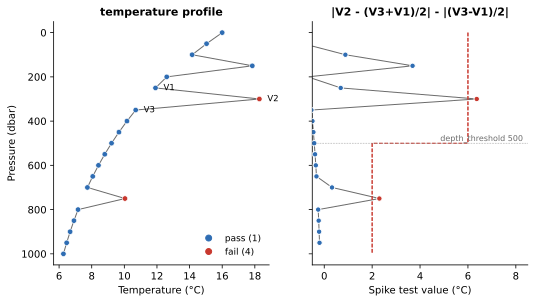

Spike
=====

:Item: ``spike``
:Test: RTQC9
:Level: observation
:Output: ``temp_qc_spike``, ``psal_qc_spike``

Why Check It
------------

A spike is a single value that differs sharply from the values just above and
below it, while those two agree with each other. Real ocean structure is
rarely that narrow; a one-level excursion usually comes from electrical
noise, a bubble or debris in the sensor, or a transmission error. The test
looks for that shape: large in size, and isolated.

How It Works
------------

For each value V2, with V1 the value above it and V3 the value below it, the
test value is

.. code-block:: text

   | V2 - (V3 + V1) / 2 |  -  | (V3 - V1) / 2 |

The first term is how far V2 is from the midpoint of its neighbours. The
second subtracts half the difference between the neighbours, so a value on a
steep but straight slope scores about zero, while a value sticking out from
two agreeing neighbours scores high. V2 fails when the test value exceeds
the threshold, which depends on depth: ``shallow`` above ``depth_threshold``
and ``deep`` from there down, since the deep ocean is much smoother than the
surface layer.

         against the depth-dependent threshold; two of the spikes fail.
   :width: 100%

   Flags computed by the item. Left: the profile, with the stencil marked at
   the spike that fails at 300 dbar. Right: the test value at every level
   against the threshold (dashed). The spike at 150 dbar (test value 3.7)
   stays under the shallow threshold of 6 °C, while a smaller one at
   750 dbar (2.3) fails the deep threshold of 2 °C.

Parameters
----------

.. code-block:: yaml

   - name: spike
     params: { temp: { shallow: 6.0, deep: 2.0 },
               psal: { shallow: 0.9, deep: 0.3 },
               depth_threshold: 500 }

``shallow`` / ``deep``
   The thresholds per variable, in the variable's units.

``depth_threshold``
   The pressure (dbar) where the deep threshold takes over.

Things to Know
--------------

* Only V2 is flagged, not its neighbours.
* A missing value (null or ``NaN``) passes, and so do its neighbours.
* The first and last observations of a profile have no complete stencil and
  always pass, as do values next to a missing one.
* A spike two levels thick is not caught: each of its values has one
  neighbour that agrees with it. The :doc:`gradient` test may catch its
  edges.
* The same formula is available as a continuous feature, ``spike_index``, in
  ``aiqclib``.
