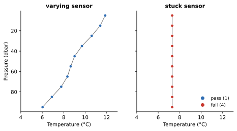

Stuck Value
===========

:Item: ``stuck_value``
:Test: RTQC13
:Level: profile (per variable)
:Output: ``temp_qc_stuck_value``, ``psal_qc_stuck_value``

Why Check It
------------

The ocean always varies with depth, at least a little. A variable that reads
exactly the same at every level of a profile is not measuring the water: the
sensor is stuck, disconnected, or reporting a default value. None of the
values can be trusted, including any that happen to look plausible, so the
whole profile of that variable is flagged.

How It Works
------------

For each profile and variable, the non-null values are counted. The variable
fails throughout the profile when **all of them are identical** and there
are at least ``min_observations`` of them.

         7.3 °C fails at every level.
   :width: 90%

   Flags computed by the item on two profiles.

Parameters
----------

.. code-block:: yaml

   - name: stuck_value
     params: { temp: {}, psal: {}, min_observations: 2 }

``temp: {}``, ``psal: {}``
   The variables to check. The empty dictionaries only mark which variables
   are enabled.

``min_observations``
   The fewest non-null values a profile needs to be judged. A single value
   cannot be "stuck", so profiles below this count pass.

Things to Know
--------------

* Each variable is judged separately: a stuck salinity sensor does not flag
  the temperature.
* A variable that was not measured at all (every value null) passes.
* Values must be exactly equal. A sensor stuck with a little noise is not
  caught.
* A very short or very shallow profile in well-mixed water can be uniform to
  the stored precision. If that is common in your data, raise
  ``min_observations``.
