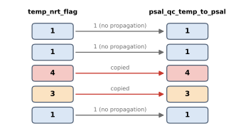

Temperature to Salinity
=======================

:Item: ``temp_to_psal``
:Test: propagation rule (not a numbered test)
:Level: observation
:Output: ``psal_qc_temp_to_psal``

Why Check It
------------

A CTD does not measure salinity directly. It computes salinity from
conductivity, temperature and pressure. If the temperature at a level is
wrong, the salinity derived from it is wrong too, even if the salinity value
itself passes every test. The recommendation therefore copies a bad
temperature flag onto salinity.

How It Works
------------

Unlike the other items, this one does not look at measurements. It reads the
**final temperature flag**, ``temp_nrt_flag``, after all the temperature
tests have been combined. Where that flag is ``3`` or ``4``, the same value is
written to ``psal_qc_temp_to_psal``; everywhere else the column is ``1``.

         and 3 are copied, 1 stays 1.
   :width: 60%

   Flags computed by the item. The copied flag keeps its severity.

The column then feeds ``psal_nrt_flag`` like any other salinity item, so the
final salinity flag is at least as severe as the final temperature flag. See
the diagram on :doc:`overview`.

Parameters
----------

.. code-block:: yaml

   - name: temp_to_psal
     params: { source_column: temp_nrt_flag, target_variable: psal }

``source_column``
   The temperature flag to propagate.

``target_variable``
   The variable receiving it; the output column is
   ``{target_variable}_qc_temp_to_psal``.

Things to Know
--------------

* The rule only makes sense when salinity is derived from temperature.
  For data where salinity is measured independently, leave the item out, or
  keep it for the record with ``include_in_final_flag: false``.
* Because it reads the final temperature flag, a temperature test excluded
  with ``include_in_final_flag: false`` does not propagate either.
* ``fail_flag`` does not apply: the copied flag keeps the temperature flag's
  value.
