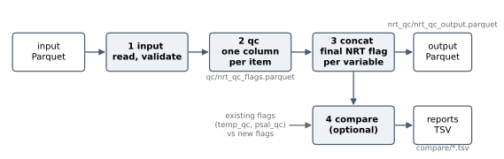

Step 4: Running NRT QC
======================

With an input file in ``~/aiqc_project/input/``, this step writes a
configuration file, runs the QC tests, and looks at what they produced.
The file name used below is ``nrt_bo_depth.parquet``, the output of
:doc:`./seastamp`. If you skipped that step, use ``nrt_bo.parquet`` and leave
out ``position_on_land``.

Writing the Configuration File
------------------------------

Start from the bundled template:

.. code-block:: python

   import nrtqclib as nq

   nq.write_config_template("~/aiqc_project/config/nrt_qc_config.yaml")

The template is a complete configuration with every QC item enabled at its
default parameters. Edit three things.

**1. The paths and the input file.** ``path_info_sets`` says where the input
is and where the output goes; ``nrt_qc_sets`` names the input file:

.. code-block:: yaml

   path_info_sets:
     - name: nrt_qc_path_1
       common:
         base_path: ~/aiqc_project/data      # output root
       input:
         base_path: ~/aiqc_project/input     # directory of the input file
         step_folder_name: ""
       concat:
         step_folder_name: nrt_qc

   nrt_qc_sets:
     - name: nrt_qc_0001
       dataset_folder_name: nrt_qc_0001
       input_file_name: nrt_bo_depth.parquet
       # ... the other keys stay as they are

**2. The regional ranges.** The regional range test has no defaults, and the
template carries example ranges for the Mediterranean. Replace them with the
ranges for your region. The values below are an illustration for the Baltic;
take the real ones from the QC manual your data centre follows:

.. code-block:: yaml

   - name: regional_range
     params: { temp: { min: -2.0, max: 24.0 },
               psal: { min: 0.0, max: 38.0 } }

.. warning::

   Leaving the Mediterranean ranges in place on Baltic data flags most of the
   file: the Mediterranean minimum temperature is 10 °C, and much of the
   Baltic is colder than that. A suspiciously high failure rate for one item
   is the first thing to check in the comparison report below.

**3. The position on land test.** It is not in the template, because it needs
the ``bathymetry`` column. Add it to the item list:

.. code-block:: yaml

   qc_item_sets:
     - name: qc_item_set_1
       items:
         - name: impossible_date
         - name: impossible_location
         - name: position_on_land     # needs the seastamp column
         # ... the other items

The defaults (``depth_column: bathymetry``, ``positive_depth: true``) match a
column written by ``seastamp depth --positive``.

.. tip::

   The example dataset of the ``aiqclib`` tutorial already carries a sea floor
   column, called ``bath`` and negative below sea level. For that file, use
   ``params: { depth_column: bath, positive_depth: false }``.

For every key of the file, see :doc:`../configuration/nrtqc`.

Reading the Configuration
-------------------------

``read_config`` validates the file and resolves the set it holds. Printing the
result summarises what a run will do, which is a quick way to catch a wrong
path or a missing item:

.. code-block:: python

   config = nq.read_config("~/aiqc_project/config/nrt_qc_config.yaml")
   print(config)

.. code-block:: text

   NRTQCConfig: nrt_qc_0001
     source    /home/user/aiqc_project/config/nrt_qc_config.yaml
     section   nrt_qc_sets (1 entry)
     schema    valid
     targets   temp (flag temp_qc, pos [4, 6, 7], neg [1])
               psal (flag psal_qc, pos [4, 6, 7], neg [1])
     qc items  impossible_date, impossible_location, position_on_land,
               global_range, regional_range, pressure_increasing, spike,
               gradient, digit_rollover, stuck_value, density_inversion,
               temp_to_psal
     ...

Running the Pipeline
--------------------

.. code-block:: python

   nq.run_nrt_qc(config)

The run goes through four steps:

         writes.
   :width: 100%

1. **input** reads and validates the Parquet file.
2. **qc** runs every configured item, producing one flag column per item and
   variable.
3. **concat** combines them into the final ``temp_nrt_flag`` and
   ``psal_nrt_flag`` and writes the output file.
4. **compare** runs only when the configuration names the input's existing
   flag columns (``flag: temp_qc``), and writes one report per variable.

The files land under ``~/aiqc_project/data/nrt_qc_0001/``:

.. code-block:: text

   nrt_qc_0001/
     qc/nrt_qc_flags.parquet                      # input + item flags
     nrt_qc/nrt_qc_output.parquet                 # input + item flags + final flags
     compare/nrt_qc_flag_comparison_temp.tsv
     compare/nrt_qc_flag_comparison_psal.tsv

``qc/nrt_qc_flags.parquet`` is an intermediate file: the output file holds the
same columns, plus the ``temp_to_psal`` flag and the final flags, and nothing
reads the intermediate file back. Set ``qc: { write_output: false }`` in
``step_param_sets`` to skip it (see :doc:`../configuration/nrtqc`).

Reading the Output
------------------

The output holds every input column, one column per item, and the two final
flags:

.. code-block:: python

   import polars as pl

   out = pl.read_parquet(
       "~/aiqc_project/data/nrt_qc_0001/nrt_qc/nrt_qc_output.parquet"
   )

   # How many observations each final flag value covers
   print(out.group_by("temp_nrt_flag").len().sort("temp_nrt_flag"))

   # Which items failed, and how often
   item_columns = [c for c in out.columns if c.startswith("qc_") or "_qc_" in c]
   print(out.select(pl.col(item_columns).ne(1).sum()))

Item columns are named ``{variable}_qc_{item}`` (``temp_qc_spike``) for the
tests that check one variable, and ``qc_{item}`` (``qc_impossible_date``)
for the tests that apply to the whole observation. The final flag of a
variable is the most severe of its own item flags and the shared ones; see
:doc:`../qc_items/overview`.

Reading the Comparison Report
-----------------------------

When the input already carries the provider's NRT flags, the report shows
how the new flags agree with them. Each TSV file has several sections,
selected with the ``section`` column:

``contingency``
   The number of observations for each pair of existing and new flag
   values.

``agreement``
   Accuracy, precision and recall, treating the ``pos_flag_values`` of the
   configuration as positives. Written only when the pos/neg values are
   given.

``item_breakdown`` and ``item_breakdown_contingency``
   For each item, how often it failed per existing flag value. This is
   where a disagreement is traced to the item behind it.

.. code-block:: python

   report = pl.read_csv(
       "~/aiqc_project/data/nrt_qc_0001/compare/nrt_qc_flag_comparison_temp.tsv",
       separator="\t",
   )
   print(report.filter(pl.col("section") == "contingency"))

A large count in the row with existing flag ``1`` and new flag ``4`` means
``nrtqclib`` rejects data the provider accepted; the ``item_breakdown``
rows then show which test is responsible, often a regional range or a
threshold that does not suit the region.

Next Steps
----------

* :doc:`../how-to/nrt_qc` covers the options in depth: handling regions,
  softening a test to flag 3, keeping a test out of the final flag, and the
  comparison report.
* :doc:`../how-to/batch_processing` runs several regions in one call.
* :doc:`../qc_items/overview` explains each test.
* To train a model on the flags, continue with the ``aiqclib`` tutorial at
  :doc:`aiqclib:tutorial/preparation`.
